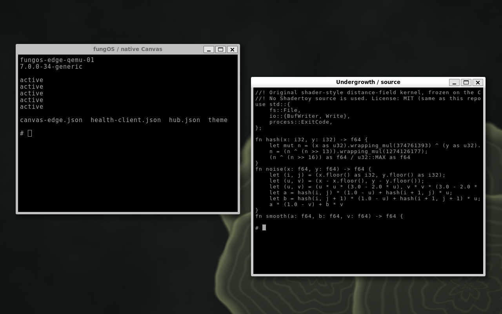

# fungOS

Bootable Debian-based nodes with Mycelium enrollment and signed software delivery.
The optional edge profile adds Unibus and the native Canvas Wayland compositor.

[Website](https://fungos.dev) · [Documentation](https://fungos.dev/docs/base.html)

Actual QEMU framebuffer capture, 6 October 2026. Native Canvas owns the Wayland/KMS
display; the applications are Weston Wayland terminals. This is a development
build, not a stable distribution release.

## Desktop

The captures are unmodified framebuffer images, not UI mockups. Each screenshot
has a matching provenance file in [`dist/assets/`](dist/assets/).
See [asset notices](ASSET-NOTICES.md) for capture details and attribution.

## What lives here

This repository owns the fungOS website and its documentation and screenshot
assets. It is **not** the OS image builder. The public distribution repository,
[ajmwagar/fungos](https://github.com/ajmwagar/fungos), contains the dual-licensed
base builder and profile declarations. Remaining qualification and integration
work is being migrated from the Mycelium development checkout's `fungOS/` directory.

[Mycelium](https://github.com/ajmwagar/mycelium) handles topology, discovery,
enrollment, access and trusted updates. Unibus provides discovery integration
and transport for the optional edge applications. The components remain
independently usable.

## Local preview

`dist/` is a static site; no asset build is required. Serve that directory with
your preferred static HTTP server.
